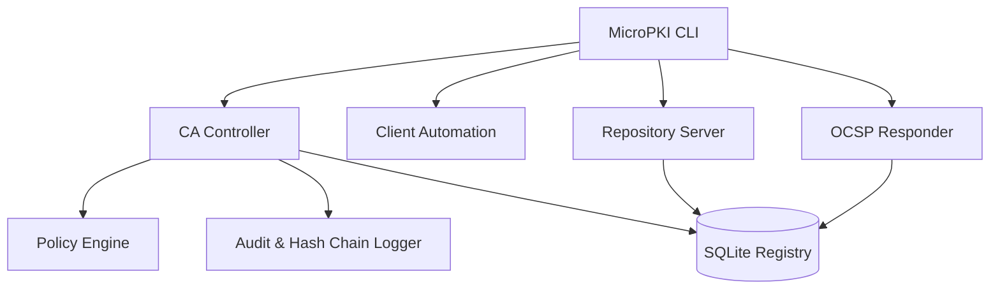

# MicroPKI

Минималистичный инструмент для создания инфраструктуры открытых ключей (PKI) в учебных целях.

## Зависимости

- Python 3.10+
- OpenSSL
- cryptography >= 46.0.0
- pytest >= 7.0

## Архитектура



## Установка

```bash
# Клонируйте репозиторий
git clone https://github.com/michaaans/MicroPKI.git
cd MicroPKI

# Создайте виртуальное окружение
python3 -m venv venv

# Активируйте (linux)
source venv/bin/activate

# Установите проект в режиме разработки
pip install -e .

# или

# Установите проект в режиме разработки ВМЕСТЕ С pytest
pip install -e ".[test]"
```

```bash
# Запуск модульных тестов

pytest

# или

pytest tests/ -v
```

Запуск с отчётом о покрытии
```bash
# Установить pytest-cov
pip install pytest-cov

# Запустить с покрытием
pytest tests/ -v --cov=micropki --cov-report=term-missing

# HTML-отчёт
pytest tests/ --cov=micropki --cov-report=html
# Открыть: htmlcov/index.html


# По умолчанию тесты производительности пропускаются. Для запуска:
pytest tests/test_sprint8.py -m perf -v -s
```

## Использование

Создание парольных фраз
```bash
# Инициализация парольной фразы для корневого УЦ
echo -n "MySecure_Passphrase_RootCA" > secrets/ca.pass

# Инициализация парольной фразы для промежуточного УЦ
echo -n "MySecure_Passphrase_IntermediateCA" > secrets/intermediate.pass
```

Инициализация БД
```bash
micropki db init --db-path ./pki/micropki.db
# Вывод: База данных инициализирована: pki\micropki.db

# миграция при изменении таблиц

micropki db init
# Вывод: Миграция схемы: версия 1 → 2...
#         Миграция на версию 2 завершена (добавлена таблица crl_metadata)
```

Инициализация корневого CA (RSA-4096)
```bash
micropki ca init \
    --subject "/CN=Demo Root CA/O=MicroPKI/C=RU" \
    --key-type rsa \
    --key-size 4096 \
    --passphrase-file secrets/ca.pass \
    --out-dir pki \
    --validity-days 3650
```

Инициализация корневого CA (ECC P-384)
```bash
micropki ca init \
    --subject "CN=ECC Root CA,O=MicroPKI" \
    --key-type ecc \
    --key-size 384 \
    --passphrase-file secrets/ca.pass \
    --out-dir pki
```

Создание промежуточного CA
```bash
micropki ca issue-intermediate \
    --root-cert pki/certs/ca.cert.pem \
    --root-key pki/private/ca.key.pem \
    --root-pass-file secrets/root.pass \
    --subject "CN=MicroPKI Intermediate CA,O=MicroPKI" \
    --key-type rsa \
    --key-size 4096 \
    --passphrase-file secrets/intermediate.pass \
    --out-dir pki \
    --validity-days 1825 \
    --pathlen 0
```

Выпуск серверного сертификата
```bash
micropki ca issue-cert \
    --ca-cert pki/certs/intermediate.cert.pem \
    --ca-key pki/private/intermediate.key.pem \
    --ca-pass-file secrets/intermediate.pass \
    --template server \
    --subject "CN=example.com,O=MicroPKI" \
    --san dns:example.com \
    --san dns:www.example.com \
    --san ip:192.168.1.10 \
    --out-dir pki/certs \
    --validity-days 365
    
# или с записью в БД

micropki ca issue-cert \
    --ca-cert pki/certs/intermediate.cert.pem \
    --ca-key pki/private/intermediate.key.pem \
    --ca-pass-file secrets/intermediate.pass \
    --template server \
    --subject "CN=example.com, O=MicroPKI" \
    --san dns:example.com --san dns:www.example.com --san ip:192.168.1.10 \
    --db-path pki/micropki.db
```

Выпуск клиентского сертификата
```bash
micropki ca issue-cert \
    --ca-cert pki/certs/intermediate.cert.pem \
    --ca-key pki/private/intermediate.key.pem \
    --ca-pass-file secrets/intermediate.pass \
    --template client \
    --subject "CN=Alice Smith" \
    --san email:alice@example.com \
    --out-dir pki/certs
    
# или с записью в БД

micropki ca issue-cert \
    --ca-cert pki/certs/intermediate.cert.pem \
    --ca-key pki/private/intermediate.key.pem \
    --ca-pass-file secrets/intermediate.pass \
    --template client \
    --subject "CN=Alice Smith" \
    --san email:alice@example.com \
    --db-path pki/micropki.db
```

Выпуск сертификата подписи кода
```bash
micropki ca issue-cert \
    --ca-cert pki/certs/intermediate.cert.pem \
    --ca-key pki/private/intermediate.key.pem \
    --ca-pass-file secrets/intermediate.pass \
    --template code_signing \
    --subject "CN=MicroPKI Code Signer" \
    --out-dir pki/certs
    
# или с записью в БД

micropki ca issue-cert \
    --ca-cert pki/certs/intermediate.cert.pem \
    --ca-key pki/private/intermediate.key.pem \
    --ca-pass-file secrets/intermediate.pass \
    --template code_signing \
    --subject "CN=MicroPKI Code Signer" \
    --db-path pki/micropki.db
```

Просмотр сертификатов
```bash
# Список всех
micropki ca list-certs

# Только действительные
micropki ca list-certs --status valid

# В формате (table/json/csv)
micropki ca list-certs --format json

# Конкретный сертификат
micropki ca show-cert 69C41A28D533E208
```

Отзыв сертификата
```bash
# Посмотреть список сертификатов чтобы найти серийный номер
micropki ca list-certs

# Отозвать с подтверждением
micropki ca revoke 69C41A28D533E208 --reason keyCompromise

# Отозвать без подтверждения
micropki ca revoke 69C41A28D533E208 --reason superseded --force
```

**Допустимые причины отзыва:**
`unspecified`, `keyCompromise`, `cACompromise`, `affiliationChanged`,
`superseded`, `cessationOfOperation`, `certificateHold`, `removeFromCRL`,
`privilegeWithdrawn`, `aACompromise`

Генерация CRL
```bash
# CRL промежуточного CA
micropki ca gen-crl \
    --ca intermediate \
    --ca-cert pki/certs/intermediate.cert.pem \
    --ca-key pki/private/intermediate.key.pem \
    --ca-pass-file secrets/intermediate.pass

# CRL корневого CA
micropki ca gen-crl \
    --ca root \
    --ca-cert pki/certs/ca.cert.pem \
    --ca-key pki/private/ca.key.pem \
    --ca-pass-file secrets/root.pass

# С указанием срока nextUpdate
micropki ca gen-crl \
    --ca intermediate \
    --ca-cert pki/certs/intermediate.cert.pem \
    --ca-key pki/private/intermediate.key.pem \
    --ca-pass-file secrets/intermediate.pass \
    --next-update 14
```

Получение CRL через HTTP
```bash
# Запуск сервера в фоне или отдельном терминале
micropki repo serve

# В другом терминале (cmd):
curl http://localhost:8080/crl --output ca.crl.pem

# С указанием параметра
curl http://localhost:8080/crl?ca=root --output root.crl.pem

# или

curl http://localhost:8080/crl?ca=intermediate --output intermediate.crl.pem
```

HTTP-сервер
```bash
# Запуск
micropki repo serve

# или 

micropki repo serve --host 127.0.0.1 --port 8080

# В другом терминале:

# Получить корневой CA
curl http://localhost:8080/ca/root

# Получить промежуточный CA
curl http://localhost:8080/ca/intermediate

# Получить сертификат по серийному номеру
curl http://localhost:8080/certificate/69C41A28D533E208

# CRL
curl http://localhost:8080/crl
curl http://localhost:8080/crl?ca=root
curl http://localhost:8080/crl?ca=intermediate

# Некорректный серийный номер
curl http://localhost:8080/certificate/XYZ
```

OCSP-Responder
```bash
# Создать цепочку CA в локальной папке (для проверки openssl)
cat ./pki/certs/intermediate.cert.pem ./pki/certs/ca.cert.pem > ./pki/certs/ca-chain.pem
```

Выпуск сертификата OCSP-ответчика
```bash
micropki ca issue-ocsp-cert \
    --ca-cert pki/certs/intermediate.cert.pem \
    --ca-key pki/private/intermediate.key.pem \
    --ca-pass-file secrets/intermediate.pass \
    --subject "CN=OCSP Responder,O=MicroPKI" \
    --key-type rsa \
    --key-size 2048 \
    --san dns:ocsp.example.com \
    --out-dir pki/certs \
    --validity-days 365 \
    --db-path pki/micropki.db
```

Проверка сертификата OCSP-ответчика
```bash
openssl x509 -in pki/certs/OCSP_Responder.cert.pem -text -noout

# В выводе должны присутствовать:
# X509v3 Basic Constraints: critical
#     CA:FALSE
# X509v3 Key Usage: critical
#     Digital Signature
# X509v3 Extended Key Usage:
#     OCSP Signing
```

Запуск OCSP-ответчика
```bash
# В отдельном терминале или в фоне
micropki ocsp serve \
    --host 127.0.0.1 \
    --port 8081 \
    --db-path pki/micropki.db \
    --responder-cert pki/certs/OCSP_Responder.cert.pem \
    --responder-key pki/certs/OCSP_Responder.key.pem \
    --ca-cert pki/certs/intermediate.cert.pem \
    --cache-ttl 120
```

Проверка работоспособности:
```bash
curl http://127.0.0.1:8081/health
# Ожидается: {"status":"ok","service":"MicroPKI OCSP Responder"}
```

Выпустить тестовый сертификат
```bash
micropki ca issue-cert \
    --ca-cert pki/certs/intermediate.cert.pem \
    --ca-key pki/private/intermediate.key.pem \
    --ca-pass-file secrets/intermediate.pass \
    --template server \
    --subject "CN=test.example.com" \
    --san dns:test.example.com \
    --out-dir pki/certs \
    --db-path pki/micropki.db
```

Запросить статус — ожидается good
```bash
openssl ocsp \
    -issuer pki/certs/intermediate.cert.pem \
    -cert pki/certs/test.example.com.cert.pem \
    -url http://127.0.0.1:8081/ocsp \
    -resp_text \
    -nonce \
    -CAfile pki/certs/ca-chain.pem \
    -verify_other pki/certs/OCSP_Responder.cert.pem

#Ожидаемый вывод:
#OCSP Response Status: successful (0x0)
#Cert Status: good
#Response verify OK
#test.example.com.cert.pem: good
#    This Update: ...
#    Next Update: ...
#Response Extensions:
#    OCSP Nonce: 0410...   ← nonce присутствует (мы передали -nonce)
```

### Nonce в OCSP и защита от повторов
Nonce (одноразовое число) в OCSP — расширение с OID 1.3.6.1.5.5.7.48.1.2, которое защищает от атак повтора (replay attacks).

**Как это работает**:
- Клиент генерирует случайное число (nonce) и включает его в OCSP-запрос.
- OCSP-ответчик обязан включить точно такое же значение nonce в ответ.
- Клиент проверяет: nonce в ответе == nonce в запросе. Если нет — ответ отвергается.

**Почему это важно**:
- Без nonce злоумышленник может перехватить старый OCSP-ответ (например, со статусом good) и предъявить его позже, даже если сертификат уже отозван. Nonce делает каждый ответ уникальным и привязанным к конкретному запросу.

# Команда client gen-csr
Генерирует закрытый ключ и CSR:
```bash
micropki client gen-csr \
    --subject "CN=myapp.local,O=MyOrg" \
    --key-type rsa \
    --key-size 2048 \
    --san dns:myapp.local \
    --san dns:www.myapp.local \
    --out-key ./myapp.key.pem \
    --out-csr ./myapp.csr.pem
 ```
Параметры:
- --subject — DN субъекта (обязательно)
- --key-type — rsa или ecc (по умолч.: rsa)
- --key-size — 2048/4096 для RSA, 256/384 для ECC
- --san — SAN записи (повторяемый флаг)
- --out-key — файл ключа (по умолч.: ./key.pem)
- --out-csr — файл CSR (по умолч.: ./request.csr.pem)

# Команда client request-cert
Отправляет CSR в сервер и получает подписанный сертификат:
```bash
micropki client request-cert \
    --csr ./myapp.csr.pem \
    --template server \
    --ca-url http://localhost:8080 \
    --out-cert ./myapp.cert.pem
```
Параметры:
- --csr — путь к CSR (обязательно)
- --template — шаблон: server, client, code_signing
- --ca-url — URL сервера репозитория
- --out-cert — файл для сертификата
- --api-key — API-ключ (если MICROPKI_API_KEY задан на сервере)

# Команда client validate
Проверяет цепочку сертификатов:
```bash
# Только цепочка (без проверки отзыва)
micropki client validate \
    --cert ./myapp.cert.pem \
    --untrusted pki/certs/intermediate.cert.pem \
    --trusted pki/certs/ca.cert.pem \
    --mode chain

# Полная проверка с CRL
micropki client validate \
    --cert ./myapp.cert.pem \
    --untrusted pki/certs/intermediate.cert.pem \
    --trusted pki/certs/ca.cert.pem \
    --mode full \
    --crl pki/crl/intermediate.crl.pem

# Полная проверка с OCSP (автоматически из AIA, или явный URL)
micropki client validate \
    --cert ./myapp.cert.pem \
    --untrusted pki/certs/intermediate.cert.pem \
    --trusted pki/certs/ca.cert.pem \
    --mode full \
    --ocsp http://127.0.0.1:8081/ocsp
    
# Коды завершения: 0 = успех, 1 = ошибка
```

# Команда client check-status
Проверяет статус отзыва (OCSP → CRL fallback):
```bash
# Автоматически OCSP из AIA сертификата, при неудаче — CRL
micropki client check-status \
    --cert ./myapp.cert.pem \
    --ca-cert pki/certs/intermediate.cert.pem

# Явный OCSP URL
micropki client check-status \
    --cert ./myapp.cert.pem \
    --ca-cert pki/certs/intermediate.cert.pem \
    --ocsp-url http://127.0.0.1:8081/ocsp

# Только CRL
micropki client check-status \
    --cert ./myapp.cert.pem \
    --ca-cert pki/certs/intermediate.cert.pem \
    --crl pki/crl/intermediate.crl.pem
    
# Коды завершения: 0 = good, 1 = revoked, 2 = unknown
```

# Журнал аудита
Журнал создаётся автоматически при первой операции CA. Расположение: pki/audit/audit.log.
```bash
# Просмотр всех записей
micropki audit query --log-file pki/audit/audit.log

# Только нарушения политик
micropki audit query --log-file pki/audit/audit.log --operation policy_violation

# Только аудитные события высокой критичности
micropki audit query --log-file pki/audit/audit.log --level AUDIT

# Проверка целостности
micropki audit verify --log-file pki/audit/audit.log
```

# CT-журнал
Создаётся автоматически при каждом выпуске сертификата. Расположение: pki/audit/ct.log.
```bash
# Проверить наличие сертификата в CT
micropki audit ct-verify --serial <СЕРИЙНЫЙ_НОМЕР> --ct-log pki/audit/ct.log

# Просмотр CT-журнала напрямую
cat pki/audit/ct.log
Компрометация ключа
Bash

# Простая компрометация (только отзыв + БД)
micropki ca compromise \
    --cert pki/certs/example.cert.pem \
    --reason keyCompromise \
    --force \
    --db-path pki/micropki.db

# С генерацией экстренного CRL
micropki ca compromise \
    --cert pki/certs/example.cert.pem \
    --reason keyCompromise \
    --force \
    --db-path pki/micropki.db \
    --ca-cert pki/certs/intermediate.cert.pem \
    --ca-key pki/private/intermediate.key.pem \
    --ca-pass-file secrets/intermediate.pass \
    --out-dir pki
```

# Rate Limiting
```bash
# Запустить сервер с ограничением 5 req/s, burst 10
micropki repo serve \
    --host 0.0.0.0 \
    --port 8080 \
    --rate-limit 5 \
    --rate-burst 10

# OCSP с ограничением
micropki ocsp serve \
    --rate-limit 10 \
    --rate-burst 20 \
#    ... (остальные параметры)
```

## TLS-демонстрация

### Подготовка

```bash
# Выпустить серверный сертификат
micropki ca issue-cert \
    --ca-cert pki/certs/intermediate.cert.pem \
    --ca-key pki/private/intermediate.key.pem \
    --ca-pass-file secrets/intermediate.pass \
    --template server \
    --subject "CN=localhost" \
    --san dns:localhost \
    --san ip:127.0.0.1 \
    --out-dir pki/certs \
    --db-path pki/micropki.db
```

```bash
# Создать цепочку CA
cat pki/certs/intermediate.cert.pem pki/certs/ca.cert.pem > pki/certs/ca-chain.pem
```

### Запуск TLS-сервера

```bash
# Терминал 1: Запустить TLS-сервер
openssl s_server \
    -cert pki/certs/localhost.cert.pem \
    -key pki/certs/localhost.key.pem \
    -CAfile pki/certs/ca.cert.pem \
    -chainCAfile pki/certs/ca-chain.pem \
    -accept 8443 \
    -www
```

### Подключение клиента
```bash
# Терминал 2: Подключиться с доверием к нашему корневому CA
openssl s_client \
    -connect localhost:8443 \
    -CAfile pki/certs/ca.cert.pem \
    -verify_return_error \
    -brief

# Ожидаемый вывод:
# CONNECTION ESTABLISHED
# Protocol version: TLSv1.3
# Verification: OK
```

### Демонстрация отзыва (TLS-3)
```bash
# 1. Найти серийный номер сертификата
micropki ca list-certs --format json

# 2. Отозвать сертификат
micropki ca revoke <СЕРИЙНЫЙ_НОМЕР> --reason keyCompromise --force

# 3. Обновить CRL
micropki ca gen-crl \
    --ca intermediate \
    --ca-cert pki/certs/intermediate.cert.pem \
    --ca-key pki/private/intermediate.key.pem \
    --ca-pass-file secrets/intermediate.pass

# 4. Проверить что отозванный сертификат отклоняется
openssl verify \
    -CAfile pki/certs/ca.cert.pem \
    -untrusted pki/certs/intermediate.cert.pem \
    -crl_check \
    -CRLfile pki/crl/intermediate.crl.pem \
    pki/certs/localhost.cert.pem

# Ожидаемый вывод:
# error 23 at 0 depth lookup: certificate revoked
```

### Подпись кода
Выпуск сертификата подписи кода
```bash
micropki ca issue-cert \
    --ca-cert pki/certs/intermediate.cert.pem \
    --ca-key pki/private/intermediate.key.pem \
    --ca-pass-file secrets/intermediate.pass \
    --template code_signing \
    --subject "CN=My Code Signer" \
    --out-dir pki/certs \
    --db-path pki/micropki.db
```

### Подписание файла
```bash
# Подписать файл
openssl dgst -sha256 \
    -sign pki/certs/My_Code_Signer.key.pem \
    -out myscript.py.sig \
    myscript.py

# Ожидаемый результат: файл myscript.py.sig создан
```

### Верификация подписи
```bash
# Извлечь открытый ключ
openssl x509 -in pki/certs/My_Code_Signer.cert.pem -pubkey -noout > /tmp/pub.pem

# Верифицировать
openssl dgst -sha256 \
    -verify /tmp/pub.pem \
    -signature myscript.py.sig \
    myscript.py

# Ожидаемый вывод: Verified OK

# Проверить что изменённый файл не проходит верификацию
echo "# tampered" >> myscript.py
openssl dgst -sha256 \
    -verify /tmp/pub.pem \
    -signature myscript.py.sig \
    myscript.py

# Ожидаемый вывод: Verification Failure
```

## Тестирование
### TEST-1
```bash
openssl x509 -in pki/certs/ca.cert.pem -text -noout

# Вывод: 
# Certificate:
#    Data:
#        Version: 3 (0x2)
#        Serial Number:
#            10:05:18:40:9d:72:cc:96:e6:42:24:57:69:2e:e1:91:69:df:ad:74
#        Signature Algorithm: sha256WithRSAEncryption
#        Issuer: CN = Demo Root CA, O = MicroPKI, C = RU
#        Validity
#            Not Before: Mar 16 12:17:10 2026 GMT
#            Not After : Mar 13 12:17:10 2036 GMT
#        Subject: CN = Demo Root CA, O = MicroPKI, C = RU
#        Subject Public Key Info:
#            Public Key Algorithm: rsaEncryption
#                Public-Key: (4096 bit)
#                Modulus:
#                    00:c0:67:e9:49:5f:6f:3b:d1:6d:b0:36:1c:2f:36:
#    .............................................................

openssl verify -CAfile pki/certs/ca.cert.pem pki/certs/ca.cert.pem

# Вывод: pki/certs/ca.cert.pem: OK
```

### TEST-2
```bash
# Подписать тестовые данные закрытым ключом
echo -n "test message" | openssl dgst -sha256 \
    -sign pki/private/ca.key.pem \
    -out /tmp/test_signature.bin

# (Вводим парольную фразу)

# Извлечь открытый ключ из сертификата
openssl x509 -in pki/certs/ca.cert.pem -pubkey -noout > /tmp/ca_pub.pem

# Проверить подпись открытым ключом из сертификата
echo -n "test message" | openssl dgst -sha256 \
    -verify /tmp/ca_pub.pem \
    -signature /tmp/test_signature.bin

# Ожидаемый вывод: Verified OK
```

### TEST-3
```bash
# Шаг 1: расшифровка ключа (вводим парольную фразу при запросе)
openssl pkey -in pki/private/ca.key.pem -noout
# Ожидаемый вывод: команда завершается без ошибок

# Шаг 2: расшифровать ключ и сразу подписать данные (доказательство загрузки для подписи)
echo -n "test data" | openssl dgst -sha256 \
    -sign pki/private/ca.key.pem \
    -out /tmp/test_sig.bin
# Ожидаемый вывод: вводим парольную фразу, файл подписи создан без ошибок

# Шаг 3: проверка с неправильной парольной фразой
openssl pkey -in pki/private/ca.key.pem -noout -passin pass:wrong_password
# Ожидаемый вывод: ошибка расшифровки

```

### TEST-4A
```bash
# Отсутствует --subject

micropki ca init --passphrase-file secrets/ca.pass
# Ожидаемый результат: ошибка argparse
```

### TEST-4B
```bash
# Неправильный --key-size для ECC

micropki ca init --subject "/CN=Test" --key-type ecc --key-size 4096 --passphrase-file secrets/ca.pass
# Ожидаемый результат: Ошибка: Для ECC, --key-size должен быть 384, получено 4096.
```

### TEST-4C
```bash
# Несуществующий --passphrase-file

micropki ca init --subject "/CN=Test" --passphrase-file nonexistent/file.pass

# Ожидаемый результат: Ошибка: Файл с парольной фразой не существует
```

### TEST-4D
```bash
# Некорректный DN

micropki ca init --subject "invalid-dn" --passphrase-file secrets/ca.pass

# Ожидаемый результат: Ошибка: Некорректный DN component: 'invalid-dn'. Ожидается KEY=VALUE
```

### TEST-5
```bash
# Модульные тесты
pytest

```

### TEST-7
```bash
# Проверка: промежуточный CA подписан корневым CA
openssl verify -CAfile pki/certs/ca.cert.pem pki/certs/intermediate.cert.pem

# Ожидаемый результат: pki/certs/intermediate.cert.pem: OK
```

### TEST-7A
```bash
# Проверка: конечный сертификат подписан промежуточным CA,
# а промежуточный — корневым (полная цепочка)
openssl verify \
    -CAfile pki/certs/ca.cert.pem \
    -untrusted pki/certs/intermediate.cert.pem \
    pki/certs/example.com.cert.pem
    
# Ожидаемый результат: pki/certs/example.com.cert.pem: OK
```

### TEST-7B
```bash
# Корневой CA — даты действия
openssl x509 -in pki/certs/ca.cert.pem -noout -dates

# Ожидаемый результат: notBefore=Mar 23 12:04:04 2026 GMT
#                      notAfter=Mar 18 12:04:04 2046 GMT
```

### TEST-7C
```bash
# Промежуточный CA — даты действия
openssl x509 -in pki/certs/intermediate.cert.pem -noout -dates

# Ожидаемый результат: notBefore=Mar 23 12:06:59 2026 GMT
#                      notAfter=Mar 22 12:06:59 2031 GMT
```

### TEST-7D
```bash
# Конечный сертификат — даты действия
openssl x509 -in pki/certs/example.com.cert.pem -noout -dates

# Ожидаемый результат: notBefore=Mar 23 12:08:06 2026 GMT
#                      notAfter=Mar 23 12:08:06 2027 GMT
```

### TEST-7E
```bash
# Корневой CA: должен быть CA:TRUE
openssl x509 -in pki/certs/ca.cert.pem -noout -text | grep -A1 "Basic Constraints"

# Ожидаемый результат:    X509v3 Basic Constraints: critical
#                             CA:TRUE  
```

### TEST-7F
```bash
# Промежуточный CA: CA:TRUE, pathlen:0
openssl x509 -in pki/certs/intermediate.cert.pem -noout -text | grep -A1 "Basic Constraints"

# Ожидаемый результат:    X509v3 Basic Constraints: critical
#                             CA:TRUE, pathlen:0
```

### TEST-7G
```bash
# Конечный сертификат: CA:FALSE
openssl x509 -in pki/certs/example.com.cert.pem -noout -text | grep -A1 "Basic Constraints"

# Ожидаемый результат:    X509v3 Basic Constraints: critical
#                             CA:FALSE
```

### TEST-8
```bash
# Расширения корневого CA
openssl x509 -in pki/certs/ca.cert.pem -text -noout

# Ожидаемый результат: Version: 3 (0x2)
# Issuer = Subject (самоподписанный)
# X509v3 Basic Constraints: critical
#       CA:TRUE
# X509v3 Key Usage: critical
#       Digital Signature, Certificate Sign, CRL Sign
# X509v3 Subject Key Identifier: <хеш>
# X509v3 Authority Key Identifier: <совпадает с SKI>
```

### TEST-8A
```bash
# Расширения промежуточного CA
openssl x509 -in pki/certs/intermediate.cert.pem -text -noout

# Ожидаемый результат: Version: 3 (0x2)
# Issuer: CN = Demo Root CA (отличается от Subject)
# Subject: CN = MicroPKI Intermediate CA
# X509v3 Basic Constraints: critical
#       CA:TRUE, pathlen:0
# X509v3 Key Usage: critical
#       Digital Signature, Certificate Sign, CRL Sign
# X509v3 Subject Key Identifier: <хеш>
# X509v3 Authority Key Identifier: <хеш корневого CA>
```

### TEST-8B
```bash
# Расширения серверного сертификата (с SAN)
openssl x509 -in pki/certs/example.com.cert.pem -text -noout

# Ожидаемый результат: Version: 3 (0x2)
# Issuer: CN = MicroPKI Intermediate CA
# X509v3 Basic Constraints: critical
#       CA:FALSE
# X509v3 Key Usage: critical
#       Digital Signature, Key Encipherment
# X509v3 Extended Key Usage:
#       TLS Web Server Authentication
# X509v3 Subject Alternative Name:
#       DNS:example.com, DNS:www.example.com, IP Address:192.168.1.10
# X509v3 Subject Key Identifier: <хеш>
# X509v3 Authority Key Identifier: <хеш промежуточного CA>
```

### TEST-8C
```bash
# Расширения клиентского сертификата
openssl x509 -in pki/certs/Alice_Smith.cert.pem -text -noout

# Ожидаемый результат: X509v3 Basic Constraints: critical
#       CA:FALSE
# X509v3 Key Usage: critical
#       Digital Signature
# X509v3 Extended Key Usage:
#       TLS Web Client Authentication
# X509v3 Subject Alternative Name:
#       email:alice@example.com
```

### TEST-8D
```bash
# Расширения сертификата подписи кода
openssl x509 -in pki/certs/MicroPKI_Code_Signer.cert.pem -text -noout

# Ожидаемый результат: X509v3 Basic Constraints: critical
#       CA:FALSE
# X509v3 Key Usage: critical
#       Digital Signature
# X509v3 Extended Key Usage:
#       Code Signing
```

### TEST-9
```bash
# Создаём файл с полной цепочкой (intermediate + root)
# для использования сервером
cat pki/certs/intermediate.cert.pem pki/certs/ca.cert.pem > pki/certs/chain.pem

# Терминал 1 — запуск TLS-сервера:
openssl s_server \
    -cert pki/certs/example.com.cert.pem \
    -key pki/certs/example.com.key.pem \
    -CAfile pki/certs/ca.cert.pem \
    -chainCAfile pki/certs/chain.pem \
    -accept 4443 \
    -www
    
# Using default temp DH parameters
# ACCEPT

# Терминал 2 — подключение TLS-клиента:

openssl s_client \
    -connect localhost:4443 \
    -CAfile pki/certs/ca.cert.pem \
    -verify 3 \
    -verify_return_error

# Ожидаемый вывод (основное): 
# depth=2 CN = Demo Root CA, O = MicroPKI, C = RU
# verify return:1
# depth=1 CN = MicroPKI Intermediate CA, O = MicroPKI
# verify return:1
# depth=0 CN = example.com, O = MicroPKI
# verify return:1
# ---
# SSL handshake has read 4500 bytes and written 373 bytes
# Verification: OK
# ---
```

### TEST-10
```bash
# Серверный сертификат без SAN
micropki ca issue-cert \
    --ca-cert pki/certs/intermediate.cert.pem \
    --ca-key pki/private/intermediate.key.pem \
    --ca-pass-file secrets/intermediate.pass \
    --template server \
    --subject "CN=no-san.example.com" \
    --out-dir pki/certs

# Ожидаемый результат: Ошибка: Шаблон 'server' требует хотя бы одну запись SAN.
```

### TEST-10A
```bash
# Неподдерживаемый тип SAN для шаблона
micropki ca issue-cert \
    --ca-cert pki/certs/intermediate.cert.pem \
    --ca-key pki/private/intermediate.key.pem \
    --ca-pass-file secrets/intermediate.pass \
    --template server \
    --subject "CN=test.com" \
    --san email:user@test.com \
    --out-dir pki/certs

# Ожидаемый результат: Ошибка: Тип SAN 'email' не допускается для шаблона 'server'. Допустимые: ['dns', 'ip']
```

### TEST-10B
```bash
# Неверная парольная фраза
echo -n "wrong_password" > secrets/wrong.pass

micropki ca issue-cert \
    --ca-cert pki/certs/intermediate.cert.pem \
    --ca-key pki/private/intermediate.key.pem \
    --ca-pass-file secrets/wrong.pass \
    --template server \
    --subject "CN=test.com" \
    --san dns:test.com \
    --out-dir pki/certs

# Ожидаемый результат: Ошибка: Incorrect password, could not decrypt key
```

### TEST-10C
```bash
# IP SAN для шаблона подписи кода
micropki ca issue-cert \
    --ca-cert pki/certs/intermediate.cert.pem \
    --ca-key pki/private/intermediate.key.pem \
    --ca-pass-file secrets/intermediate.pass \
    --template code_signing \
    --subject "CN=Code Signer" \
    --san ip:1.2.3.4 \
    --out-dir pki/certs

# Ожидаемый результат: Ошибка: Тип SAN 'ip' не допускается для шаблона 'code_signing'. Допустимые: ['dns', 'uri']
```

### TEST-11
```bash
# Проверка промежуточного CA
openssl verify -CAfile pki/certs/ca.cert.pem pki/certs/intermediate.cert.pem

# Ожидаемый результат: pki/certs/intermediate.cert.pem: OK
```

### TEST-11A
```bash
# Проверка конечного сертификата с полной цепочкой
openssl verify \
    -CAfile pki/certs/ca.cert.pem \
    -untrusted pki/certs/intermediate.cert.pem \
    pki/certs/example.com.cert.pem

# Ожидаемый результат: pki/certs/example.com.cert.pem: OK
```

### TEST-11B
```bash
# Проверка клиентского сертификата
openssl verify \
    -CAfile pki/certs/ca.cert.pem \
    -untrusted pki/certs/intermediate.cert.pem \
    pki/certs/Alice_Smith.cert.pem

# Ожидаемый результат: pki/certs/Alice_Smith.cert.pem: OK
```

### TEST-11C
```bash
# Проверка сертификата подписи кода
openssl verify \
    -CAfile pki/certs/ca.cert.pem \
    -untrusted pki/certs/intermediate.cert.pem \
    pki/certs/MicroPKI_Code_Signer.cert.pem

# Ожидаемый результат: pki/certs/MicroPKI_Code_Signer.cert.pem: OK
```

### TEST-12
```bash
# Модульные тесты
pytest

# Ожидаемый результат:
========================================= test session starts ==========================================
configfile: pyproject.toml
collected 31 items

tests/test_csr.py ...                                                                                    [  9%]
tests/test_negative.py ....                                                                              [ 22%]
tests/test_san.py ...........                                                                            [ 58%]
tests/test_templates.py .............                                                                    [100%]

========================================== 31 passed in 2.27s ==========================================
```

### TEST-13
```bash
# Сертификат 1: серверный
micropki ca issue-cert --ca-cert pki/certs/intermediate.cert.pem --ca-key pki/private/intermediate.key.pem --ca-pass-file secrets/intermediate.pass --template server --subject "cn=server1.example.com" --san dns:server1.example.com --db-path pki/micropki.db

# Сертификат 2: серверный с несколькими SAN
micropki ca issue-cert --ca-cert pki/certs/intermediate.cert.pem --ca-key pki/private/intermediate.key.pem --ca-pass-file secrets/intermediate.pass --template server --subject "cn=server2.example.com" --san dns:server2.example.com --san dns:www.server2.example.com --san ip:10.0.0.2 --db-path pki/micropki.db

# Сертификат 3: клиентский
micropki ca issue-cert --ca-cert pki/certs/intermediate.cert.pem --ca-key pki/private/intermediate.key.pem --ca-pass-file secrets/intermediate.pass --template client --subject "cn=alice" --san email:alice@example.com --db-path pki/micropki.db

# Сертификат 4: клиентский
micropki ca issue-cert --ca-cert pki/certs/intermediate.cert.pem --ca-key pki/private/intermediate.key.pem --ca-pass-file secrets/intermediate.pass --template client --subject "cn=bob" --san email:bob@example.com --db-path pki/micropki.db

# Сертификат 5: подпись кода
micropki ca issue-cert --ca-cert pki/certs/intermediate.cert.pem --ca-key pki/private/intermediate.key.pem --ca-pass-file secrets/intermediate.pass --template code_signing --subject "cn=code signer" --db-path pki/micropki.db

# Проверка: вывести все сертификаты из БД
micropki ca list-certs

# Ожидаемый вывод: 
# Serial           | Subject                        | Not After  | Status
# -----------------+--------------------------------+------------+-------
# 69C42B5FE4242E60 | commonName=code signer         | 2027-03-25 | valid
# 69C42B5A367058FC | commonName=bob                 | 2027-03-25 | valid
# 69C42B558DEEF815 | commonName=alice               | 2027-03-25 | valid
# 69C42B50447D5A48 | commonName=server2.example.com | 2027-03-25 | valid
# 69C42B45108C0DD0 | commonName=server1.example.com | 2027-03-25 | valid
```

### TEST-14
```bash
# Список всех действительных сертификатов
micropki ca list-certs --status valid
# Ожидаемый вывод: таблица с серийными номерами, субъектами, датами, статусами

# Список в формате JSON
micropki ca list-certs --format json
# Ожидаемый вывод: JSON-массив с объектами

# Список в формате CSV
micropki ca list-certs --format csv
# Ожидаемый вывод: CSV с заголовками

# Показать конкретный сертификат
micropki ca show-cert 69C42B45108C0DD0

# Ожидаемый вывод:
# -----BEGIN CERTIFICATE-----
# MIIEbTCCAlWgAwIBAgIIacQrRRCMDdAwDQYJKoZIhvcNAQELBQAwNjEhMB8GA1UE...
# -----END CERTIFICATE-----
```

### TEST-15
```bash

# Запуск сервера (в отдельном терминале)
micropki repo serve --host 127.0.0.1 --port 8080

# В другом терминале:

# Получить сертификат по серийному номеру
curl http://localhost:8080/certificate/69C42B45108C0DD0 --output cert.pem
# Ожидаемый вывод: PEM-сертификат

# Сравнить с файлом на диске
diff -s cert.pem pki/certs/server1.example.com.cert.pem
# Ожидаемый вывод: Files cert.pem and pki/certs/server1.example.com.cert.pem are identical
```

### TEST-16
```bash
# Модульные тесты
pytest tests/test_api.py -v

# Ожидаемый результат:
========================================= test session starts ==========================================
configfile: pyproject.toml
collected 4 items

tests/test_api.py::test_get_root_ca PASSED                                                               [ 25%]
tests/test_api.py::test_get_intermediate_ca PASSED                                                       [ 50%]
tests/test_api.py::test_get_ca_unknown_level PASSED                                                      [ 75%]
tests/test_api.py::test_crl_returns_501 PASSED                                                           [100%]

========================================== 4 passed in 5.88s ==========================================
```

### TEST-17, TEST-18
```bash
# Модульные тесты
pytest tests/test_serial.py -v

# Ожидаемый результат:
========================================= test session starts ==========================================
configfile: pyproject.toml
collected 5 items

tests/test_serial.py::test_serial_format PASSED                                                          [ 20%]
tests/test_serial.py::test_serial_to_hex_roundtrip PASSED                                                [ 40%]
tests/test_serial.py::test_is_valid_hex PASSED                                                           [ 60%]
tests/test_serial.py::test_generate_100_unique_serials PASSED                                            [ 80%]
tests/test_serial.py::test_duplicate_serial_rejected PASSED                                              [100%]

========================================== 5 passed in 0.81s ==========================================
```

### TEST-19
```bash
# Сервер должен быть запущен

# Некорректный hex
curl http://localhost:8080/certificate/XYZ
# Ожидаемый вывод: 400 Bad Request, сообщение об ошибке

curl http://localhost:8080/certificate/ZZZZ
# Ожидаемый вывод: 400 Bad Request

# Несуществующий, но валидный hex
curl http://localhost:8080/certificate/DEADBEEF
# Ожидаемый вывод: 404 Not Found
```

### TEST-20
```bash
# Инициализация БД
micropki db init

# Промежуточный CA
micropki ca issue-intermediate --root-cert pki/certs/ca.cert.pem --root-key pki/private/ca.key.pem --root-pass-file secrets/root.pass --subject "CN=Integration Intermediate CA" --passphrase-file secrets/intermediate.pass --db-path pki/micropki.db

# 3 конечных сертификата
micropki ca issue-cert --ca-cert pki/certs/intermediate.cert.pem --ca-key pki/private/intermediate.key.pem --ca-pass-file secrets/intermediate.pass --template server --subject "cn=test1.local" --san dns:test1.local --db-path pki/micropki.db

micropki ca issue-cert --ca-cert pki/certs/intermediate.cert.pem --ca-key pki/private/intermediate.key.pem --ca-pass-file secrets/intermediate.pass --template client --subject "cn=testclient" --san email:test@local.com --db-path pki/micropki.db

micropki ca issue-cert --ca-cert pki/certs/intermediate.cert.pem --ca-key pki/private/intermediate.key.pem --ca-pass-file secrets/intermediate.pass --template code_signing --subject "cn=testsigner" --db-path pki/micropki.db

# Проверяем БД
micropki ca list-certs
# Ожидаемый вывод: 4 записи (intermediate + 3 конечных)

# Запуск сервера (в отдельном терминале)
micropki repo serve

# Получение через API
curl http://localhost:8080/certificate/<СЕРИЙНЫЙ_НОМЕР_test1.local> --output cert.pem
# Ожидаемый вывод: PEM-сертификат

# Сравнение
diff -s cert.pem pki/certs/test1.local.cert.pem
# Содержимое из API должно совпадать с файлом pki/certs/test1.local.cert.pem

# Проверка CA-эндпоинтов
curl http://localhost:8080/ca/root
curl http://localhost:8080/ca/intermediate
# Ожидаемый вывод: PEM-сертификаты корневого и промежуточного CA
```

### TEST-21
```bash
# 1. Выпустить серверный сертификат
micropki ca issue-cert \
    --ca-cert pki/certs/intermediate.cert.pem \
    --ca-key pki/private/intermediate.key.pem \
    --ca-pass-file secrets/intermediate.pass \
    --template server \
    --subject "cn=revoke-test.local" \
    --san dns:revoke-test.local \
    --db-path pki/micropki.db

# 2. Проверить статус — должен быть valid
micropki ca list-certs --status valid
# Ожидаемый вывод: запись с revoke-test.local, статус valid

# 3. Отозвать с причиной keyCompromise
micropki ca revoke 69CA97F1887C8399 --reason keyCompromise --force
# Ожидаемый вывод: Сертификат 69CA97F1887C8399 успешно отозван.

# 4. Проверить статус — должен быть revoked
micropki ca list-certs --status revoked
# Ожидаемый вывод: запись с revoke-test.local, статус revoked

# 5. Сгенерировать CRL
micropki ca gen-crl \
    --ca intermediate \
    --ca-cert pki/certs/intermediate.cert.pem \
    --ca-key pki/private/intermediate.key.pem \
    --ca-pass-file secrets/intermediate.pass

# 6. Проверить что CRL содержит отозванный серийный номер
openssl crl -in pki/crl/intermediate.crl.pem -text -noout
# Ожидаемый вывод:
#   Revoked Certificates:
#       Serial Number: 69CA97F1887C8399
#           Revocation Date: Mar 30 15:35:12 2026 GMT
#           CRL entry extensions:
#               X509v3 CRL Reason Code:
#                   Key Compromise

# 7. Запустить сервер и получить CRL через HTTP
micropki repo serve

curl http://localhost:8080/crl -o ca.crl.pem

# Проверяем что CRL одинаковые
openssl crl -in ca.crl.pem -text -noout

# или

diff -s ca.crl.pem pki/crl/intermediate.crl.pem
# Ожидаемый вывод: Files ca.crl.pem and pki/crl/intermediate.crl.pem are identical
```

### TEST-22
```bash
openssl crl -in pki/crl/intermediate.crl.pem -CAfile pki/certs/intermediate.cert.pem -noout
# Ожидаемый вывод: verify OK
```

### TEST-23
```bash
# Первая генерация
micropki ca gen-crl --ca intermediate --ca-cert pki/certs/intermediate.cert.pem --ca-key pki/private/intermediate.key.pem --ca-pass-file secrets/intermediate.pass
openssl crl -in pki/crl/intermediate.crl.pem -text -noout
# Ожидаемый вывод: 
#Certificate Revocation List (CRL):
#        Version 2 (0x1)
#        Signature Algorithm: sha256WithRSAEncryption
#        Issuer: CN = MicroPKI Intermediate CA, O = MicroPKI
#        Last Update: Mar 30 15:46:22 2026 GMT
#        Next Update: Apr  6 15:46:22 2026 GMT
#        CRL extensions:
#            X509v3 CRL Number:
#                3  (номер CRL равен 3)

# Вторая генерация (без новых отзывов)
micropki ca gen-crl --ca intermediate --ca-cert pki/certs/intermediate.cert.pem --ca-key pki/private/intermediate.key.pem --ca-pass-file secrets/intermediate.pass
openssl crl -in pki/crl/intermediate.crl.pem -text -noout | findstr "CRL Number"
# Ожидаемый вывод: 
#Certificate Revocation List (CRL):
#        Version 2 (0x1)
#        Signature Algorithm: sha256WithRSAEncryption
#        Issuer: CN = MicroPKI Intermediate CA, O = MicroPKI
#        Last Update: Mar 30 15:51:23 2026 GMT
#        Next Update: Apr  6 15:51:23 2026 GMT
#        CRL extensions:
#            X509v3 CRL Number:
#                4  (увеличился на 1)
```

### TEST-24
```bash
micropki ca revoke DEADBEEF12345678 --reason unspecified --force
# Ожидаемый вывод:
# 2026-03-30T18:52:47 ERROR Сертификат не найден в БД: DEADBEEF12345678
# Сертификат с серийным номером DEADBEEF12345678 не найден в базе данных.
```

### TEST-25
```bash
micropki ca revoke 69CA97F1887C8399 --reason superseded --force
# Ожидаемый вывод:
# 2026-03-30T18:54:15 WARNING Сертификат уже отозван: serial=69CA97F1887C8399, subject=commonName=revoke-test.local, причина=keycompromise, дата=2026-03-30T15:35:12Z
# Сертификат 69CA97F1887C8399 уже отозван.
```

### TEST-26
```bash
# Запускаем сервер
micropki repo serve

# Отзываем сертификат
micropki ca revoke 69C42F7CAE83C15A

# Перегенерируем CRL
micropki ca gen-crl \
    --ca intermediate \
    --ca-cert pki/certs/intermediate.cert.pem \
    --ca-key pki/private/intermediate.key.pem \
    --ca-pass-file secrets/intermediate.pass

# Получаем CRL по HTTP
curl http://localhost:8080/crl --output ca.crl.pem

# Сравниваем с локальным файлом:

diff -s ca.crl.pem pki/crl/intermediate.crl.pem
# Ожидаемый вывод: Files ca.crl.pem and pki/crl/intermediate.crl.pem are identical
```

### TEST-28
```bash
# Выпустить сертификат OCSP-ответчика
micropki ca issue-ocsp-cert \
    --ca-cert pki/certs/intermediate.cert.pem \
    --ca-key pki/private/intermediate.key.pem \
    --ca-pass-file secrets/intermediate.pass \
    --subject "CN=OCSP Responder,O=MicroPKI" \
    --key-type rsa \
    --key-size 2048 \
    --san dns:ocsp.example.com \
    --out-dir pki/certs \
    --db-path pki/micropki.db
# Ожидаемый вывод:
#   ПРЕДУПРЕЖДЕНИЕ: Ключ OCSP-ответчика сохранён без шифрования!
#   Сертификат OCSP-ответчика: pki/certs/OCSP_Responder.cert.pem
#   Ключ OCSP-ответчика: pki/certs/OCSP_Responder.key.pem

# Проверить расширения
openssl x509 -in pki/certs/OCSP_Responder.cert.pem -text -noout
# Ожидаемый вывод (фрагмент):
#   X509v3 Basic Constraints: critical
#       CA:FALSE
#   X509v3 Key Usage: critical
#       Digital Signature
#   X509v3 Extended Key Usage:
#       OCSP Signing
#   (НЕТ keyCertSign, НЕТ cRLSign)

# Проверить что сертификат подписан промежуточным CA
openssl verify \
    -CAfile pki/certs/ca.cert.pem \
    -untrusted pki/certs/intermediate.cert.pem \
    pki/certs/OCSP_Responder.cert.pem
# Ожидаемый вывод: pki/certs/OCSP_Responder.cert.pem: OK
```

### TEST-29
```bash
# Выпустить серверный сертификат для теста
micropki ca issue-cert \
    --ca-cert pki/certs/intermediate.cert.pem \
    --ca-key pki/private/intermediate.key.pem \
    --ca-pass-file secrets/intermediate.pass \
    --template server \
    --subject "CN=ocsp-test.local" \
    --san dns:ocsp-test.local \
    --out-dir pki/certs \
    --db-path pki/micropki.db

# Запустить OCSP-ответчик (в отдельном терминале)
micropki ocsp serve \
    --responder-cert pki/certs/OCSP_Responder.cert.pem \
    --responder-key pki/certs/OCSP_Responder.key.pem \
    --ca-cert pki/certs/intermediate.cert.pem \
    --db-path pki/micropki.db \
    --port 8081

# Запросить статус с nonce и верификацией подписи
openssl ocsp \
    -issuer pki/certs/intermediate.cert.pem \
    -cert pki/certs/ocsp-test.local.cert.pem \
    -url http://127.0.0.1:8081/ocsp \
    -resp_text \
    -nonce \
    -CAfile pki/certs/ca-chain.pem \
    -verify_other pki/certs/OCSP_Responder.cert.pem
# Ожидаемый вывод:
# Response Extensions:
#         OCSP Nonce:
#             04106765B414A0B3636DB65082DA782E1F86
# Response verify OK
# pki/certs/ocsp-test.local.cert.pem: revoked
#         This Update: Apr  6 15:03:13 2026 GMT
#         Next Update: Apr  6 15:05:13 2026 GMT
#         Reason: keyCompromise
#         Revocation Time: Apr  6 12:02:22 2026 GMT
```

### TEST-30
```bash
# Получить серийный номер сертификата ocsp-test.local
micropki ca list-certs --db-path pki/micropki.db --format json
# Найти serial_hex для CN=ocsp-test.local

# Отозвать сертификат
micropki ca revoke 69D3A07DB8063AE9 \
    --reason keyCompromise \
    --force \
    --db-path pki/micropki.db
# Ожидаемый вывод: Сертификат 69D3A07DB8063AE9 успешно отозван.

# Запросить статус через OCSP (ответчик должен быть запущен)
openssl ocsp \
    -issuer pki/certs/intermediate.cert.pem \
    -cert pki/certs/ocsp-test.local.cert.pem \
    -url http://127.0.0.1:8081/ocsp \
    -resp_text \
    -no_nonce \
    -CAfile pki/certs/ca-chain.pem \
    -verify_other pki/certs/OCSP_Responder.cert.pem
# Ожидаемый вывод:
# Response verify OK
# pki/certs/ocsp-test.local.cert.pem: revoked
#         This Update: Apr  6 15:05:13 2026 GMT
#         Next Update: Apr  6 15:07:13 2026 GMT
#         Reason: keyCompromise
#         Revocation Time: Apr  6 12:02:22 2026 GMT
```

### TEST-31
```bash
# Запросить несуществующий серийный номер
openssl ocsp \
    -issuer pki/certs/intermediate.cert.pem \
    -serial 0xDEADBEEF00000001 \
    -url http://127.0.0.1:8081/ocsp \
    -resp_text \
    -no_nonce \
    -CAfile pki/certs/ca-chain.pem \
    -verify_other pki/certs/OCSP_Responder.cert.pem
# Ожидаемый вывод:
# Response verify OK
# 0xDEADBEEF00000001: unknown
#         This Update: Apr  6 15:06:06 2026 GMT
#         Next Update: Apr  6 15:08:06 2026 GMT
```

### TEST-32
```bash
# Запрос С nonce (-nonce)
openssl ocsp \
    -issuer pki/certs/intermediate.cert.pem \
    -cert pki/certs/ocsp-test.local.cert.pem \
    -url http://127.0.0.1:8081/ocsp \
    -resp_text \
    -nonce \
    -CAfile pki/certs/ca-chain.pem \
    -verify_other pki/certs/OCSP_Responder.cert.pem
# Ожидаемый вывод: 
# Response Extensions:
#         OCSP Nonce:
#             0410AA55864FFD23C7BB31662F2ADADC7295

# Запрос БЕЗ nonce (-no_nonce)
openssl ocsp \
    -issuer pki/certs/intermediate.cert.pem \
    -cert pki/certs/ocsp-test.local.cert.pem \
    -url http://127.0.0.1:8081/ocsp \
    -resp_text \
    -no_nonce \
    -CAfile pki/certs/ca-chain.pem \
    -verify_other pki/certs/OCSP_Responder.cert.pem
# Ожидаемый вывод: секция "Response Extensions" отсутствует
```

### TEST-33
```bash
# Сохранить ответ в файл
openssl ocsp \
    -issuer pki/certs/intermediate.cert.pem \
    -cert pki/certs/ocsp-test.local.cert.pem \
    -url http://127.0.0.1:8081/ocsp \
    -respout pki/ocsp/response.der \
    -no_nonce \
    -CAfile pki/certs/ca-chain.pem \
    -verify_other pki/certs/OCSP_Responder.cert.pem
# Ожидаемый вывод: Response verify OK

# Верифицировать сохранённый ответ отдельно
openssl ocsp \
    -respin pki/ocsp/response.der \
    -CAfile pki/certs/ca-chain.pem \
    -verify_other pki/certs/OCSP_Responder.cert.pem \
    -no_nonce
# Ожидаемый вывод: Response verify OK
```

### TEST-34
```bash
# Создать файл с мусорными данными
printf '\x00\x01\x02\x03\xff\xfe' > /tmp/bad_request.der

# Отправить некорректный запрос
curl -s -X POST http://127.0.0.1:8081/ocsp \
    -H "Content-Type: application/ocsp-request" \
    --data-binary @/tmp/bad_request.der \
    -o /tmp/bad_response.der \
    -w "\nHTTP Status: %{http_code}\n"
# Ожидаемый вывод: HTTP Status: 400

# Проверить что ответ — корректный OCSP malformedRequest
openssl ocsp -respin /tmp/bad_response.der -resp_text 2>&1 | head -3
# Ожидаемый вывод:
#   OCSP Response Data:
#       OCSP Response Status: malformedRequest (0x1)
```

### TEST-35
```bash
# Создать сертификат от неизвестного CA
openssl req -x509 -newkey rsa:2048 \
    -keyout /tmp/unknown_ca.key.pem \
    -out /tmp/unknown_ca.cert.pem \
    -days 1 -nodes \
    -subj "/CN=Unknown CA"

openssl req -newkey rsa:2048 \
    -keyout /tmp/foreign.key.pem \
    -out /tmp/foreign.csr.pem \
    -nodes \
    -subj "/CN=foreign.example.com"

openssl x509 -req \
    -in /tmp/foreign.csr.pem \
    -CA /tmp/unknown_ca.cert.pem \
    -CAkey /tmp/unknown_ca.key.pem \
    -CAcreateserial \
    -out /tmp/foreign.cert.pem \
    -days 1

# Запросить статус — издатель не наш CA
openssl ocsp \
    -issuer pki/certs/intermediate.cert.pem \
    -cert /tmp/foreign.cert.pem \
    -url http://127.0.0.1:8081/ocsp \
    -resp_text \
    -no_nonce \
    -CAfile pki/certs/ca-chain.pem \
    -verify_other pki/certs/OCSP_Responder.cert.pem
# Ожидаемый вывод:
#   Response verify OK
#   /tmp/foreign.cert.pem: unknown
```

### TEST-37
```bash
# Выпустить новый сертификат
micropki ca issue-cert \
    --ca-cert pki/certs/intermediate.cert.pem \
    --ca-key pki/private/intermediate.key.pem \
    --ca-pass-file secrets/intermediate.pass \
    --template server \
    --subject "CN=integration-test.local" \
    --san dns:integration-test.local \
    --out-dir pki/certs \
    --db-path pki/micropki.db

# Выпустить сертификат OCSP-ответчика
micropki ca issue-ocsp-cert \
    --ca-cert pki/certs/intermediate.cert.pem \
    --ca-key pki/private/intermediate.key.pem \
    --ca-pass-file secrets/intermediate.pass \
    --subject "CN=OCSP Responder,O=MicroPKI" \
    --key-type rsa \
    --key-size 2048 \
    --san dns:ocsp.example.com \
    --out-dir pki/certs \
    --validity-days 365 \
    --db-path pki/micropki.db

# Запустить OCSP-ответчик
micropki ocsp serve \
    --host 127.0.0.1 \
    --port 8081 \
    --db-path pki/micropki.db \
    --responder-cert pki/certs/OCSP_Responder.cert.pem \
    --responder-key pki/certs/OCSP_Responder.key.pem \
    --ca-cert pki/certs/intermediate.cert.pem \
    --cache-ttl 120

# Проверить работу ответчика
curl http://127.0.0.1:8081/health
# Ожидаемый вывод: {"status":"ok","service":"MicroPKI OCSP Responder"}

# Статус — ожидается good
openssl ocsp \
    -issuer pki/certs/intermediate.cert.pem \
    -cert pki/certs/integration-test.local.cert.pem \
    -url http://127.0.0.1:8081/ocsp \
    -resp_text -nonce \
    -CAfile pki/certs/ca-chain.pem \
    -verify_other pki/certs/OCSP_Responder.cert.pem
# Ожидаемый вывод:
#   Response verify OK
#   integration-test.local.cert.pem: good

# Получить серийный номер
micropki ca list-certs --db-path pki/micropki.db
# Найти serial_hex для CN=integration-test.local

# Отозвать
micropki ca revoke 69D39E3502A0098F \
    --reason superseded \
    --force \
    --db-path pki/micropki.db
# Ожидаемый вывод: Сертификат 69D39E3502A0098F успешно отозван.

# Статус — ожидается revoked
openssl ocsp \
    -issuer pki/certs/intermediate.cert.pem \
    -cert pki/certs/integration-test.local.cert.pem \
    -url http://127.0.0.1:8081/ocsp \
    -resp_text -nonce \
    -CAfile pki/certs/ca-chain.pem \
    -verify_other pki/certs/OCSP_Responder.cert.pem
# Ожидаемый вывод:
# Response verify OK
# pki/certs/integration-test.local.cert.pem: revoked
#         This Update: Apr  6 15:11:29 2026 GMT
#         Next Update: Apr  6 15:13:29 2026 GMT
#         Reason: superseded
#         Revocation Time: Apr  6 11:52:38 2026 GMT
```

### TEST-38
```bash
# Сгенерировать RSA-ключ и CSR
micropki client gen-csr \
    --subject "CN=app.example.com,O=MicroPKI" \
    --key-type rsa \
    --key-size 2048 \
    --san dns:app.example.com \
    --san dns:api.example.com \
    --out-key ./app.key.pem \
    --out-csr ./app.csr.pem

# Ожидаемый вывод (stderr):
# ПРЕДУПРЕЖДЕНИЕ: Закрытый ключ сохранён БЕЗ шифрования!
#   Файл: app.key.pem
#   Защитите файл от несанкционированного доступа.
#
# Ожидаемый вывод (stdout):
# Закрытый ключ: app.key.pem
# CSR:           app.csr.pem

# Проверить ключ — должен быть незашифрованным
openssl pkey -in app.key.pem -noout
# Ожидаемый вывод: команда завершается без запроса пароля

# Проверить CSR — субъект и SAN
openssl req -in app.csr.pem -text -noout
# Ожидаемый вывод (фрагмент):
# Subject: CN=app.example.com, O=MicroPKI
# X509v3 Subject Alternative Name:
#     DNS:app.example.com, DNS:api.example.com

# Проверить подпись CSR
openssl req -in app.csr.pem -verify -noout
# Ожидаемый вывод: Certificate request self-signature verify OK

# Проверить права на ключ (Linux/macOS)
ls -la app.key.pem
# Ожидаемый вывод: -rw------- (600)

# Сгенерировать ECC CSR
micropki client gen-csr \
    --subject "CN=ecc.example.com" \
    --key-type ecc \
    --key-size 256 \
    --san dns:ecc.example.com \
    --out-key ./ecc.key.pem \
    --out-csr ./ecc.csr.pem

openssl req -in ecc.csr.pem -text -noout | grep "Public Key Algorithm"
# Ожидаемый вывод: Public Key Algorithm: id-ecPublicKey
```

### TEST-39
```bash
# Предварительно: запустить сервер (в отдельном терминале)
MICROPKI_CA_PASS="$(cat secrets/intermediate.pass)" micropki repo serve --host 127.0.0.1 --port 8080

# Сгенерировать CSR (если ещё не сделано)
micropki client gen-csr \
    --subject "CN=app.example.com,O=MicroPKI" \
    --key-type rsa \
    --key-size 2048 \
    --san dns:app.example.com \
    --out-key ./app.key.pem \
    --out-csr ./app.csr.pem

# Запросить сертификат через API
micropki client request-cert \
    --csr ./app.csr.pem \
    --template server \
    --ca-url http://localhost:8080 \
    --out-cert ./app.cert.pem

# Ожидаемый вывод:
# Сертификат сохранён: app.cert.pem

# Проверить сертификат
openssl x509 -in app.cert.pem -text -noout
# Ожидаемый вывод (фрагмент):
# Subject: CN=app.example.com, O=MicroPKI
# X509v3 Subject Alternative Name:
#     DNS:app.example.com
# X509v3 Basic Constraints: critical
#     CA:FALSE
# X509v3 Extended Key Usage:
#     TLS Web Server Authentication

# Проверить что CN из CSR совпадает с CN в сертификате
openssl req -in app.csr.pem -noout -subject
openssl x509 -in app.cert.pem -noout -subject
# Ожидаемый вывод: оба должны содержать CN=app.example.com
```

### TEST-40
```bash
# Предварительно: выпустить сертификат через API (или ca issue-cert)
# Убедиться что есть:
#   app.cert.pem            — конечный сертификат
#   pki/certs/intermediate.cert.pem — промежуточный CA
#   pki/certs/ca.cert.pem   — корневой CA

micropki client validate \
    --cert ./app.cert.pem \
    --untrusted ./pki/certs/intermediate.cert.pem \
    --trusted ./pki/certs/ca.cert.pem \
    --mode chain

# Ожидаемый вывод:
# Результат проверки цепочки: УСПЕХ
# Цепочка сертификатов:
#   [0] CN=app.example.com,O=MicroPKI
#   [1] CN=MicroPKI Intermediate CA,O=MicroPKI
#   [2] CN=Demo Root CA,O=MicroPKI,C=RU
#
# Сертификат: CN=app.example.com,O=MicroPKI
#   Подпись верна (подписан: CN=MicroPKI Intermediate CA,O=MicroPKI)
#   Срок действия в норме (2026-... — 2027-...)
#   BasicConstraints: CA=False (ожидалось CA=False)
#   KeyUsage: digitalSignature присутствует (критичное)
# ...
```

### TEST-41
```bash
# Выпустить сертификат с коротким сроком (1 день)
micropki ca issue-cert \
    --ca-cert pki/certs/intermediate.cert.pem \
    --ca-key pki/private/intermediate.key.pem \
    --ca-pass-file secrets/intermediate.pass \
    --template server \
    --subject "CN=short-lived.example.com" \
    --san dns:short-lived.example.com \
    --validity-days 1 \
    --out-dir pki/certs \
    --db-path pki/micropki.db

# Проверить с текущим временем — должно пройти
micropki client validate \
    --cert pki/certs/short-lived.example.com.cert.pem \
    --untrusted pki/certs/intermediate.cert.pem \
    --trusted pki/certs/ca.cert.pem \
    --mode chain

# Ожидаемый вывод: Результат проверки цепочки: УСПЕХ

# Проверить с временем в будущем (через 400 дней)
# Вычислить дату (Linux):
FUTURE=$(date -u -d "+400 days" "+%Y-%m-%dT%H:%M:%SZ" 2>/dev/null || \
         date -u -v+400d "+%Y-%m-%dT%H:%M:%SZ")
echo "Будущая дата: $FUTURE"

micropki client validate \
    --cert pki/certs/short-lived.example.com.cert.pem \
    --untrusted pki/certs/intermediate.cert.pem \
    --trusted pki/certs/ca.cert.pem \
    --mode chain \
    --validation-time "$FUTURE"

# Ожидаемый вывод:
# Результат проверки цепочки: ОШИБКА
# ...
#   Сертификат просрочен. notAfter=...
# Ошибка в сертификате [...]: Сертификат просрочен...
```

### TEST-43
```bash
# Выпустить тестовый сертификат
micropki ca issue-cert \
    --ca-cert pki/certs/intermediate.cert.pem \
    --ca-key pki/private/intermediate.key.pem \
    --ca-pass-file secrets/intermediate.pass \
    --template server \
    --subject "CN=crl-check.example.com" \
    --san dns:crl-check.example.com \
    --out-dir pki/certs \
    --db-path pki/micropki.db

# Найти серийный номер
micropki ca list-certs --status valid --format json
# Найти serial_hex для CN=crl-check.example.com

# Отозвать сертификат
micropki ca revoke 69D39E3502A0098F --reason keyCompromise --force
# Ожидаемый вывод: Сертификат 69D39E3502A0098F успешно отозван.

# Сгенерировать CRL
micropki ca gen-crl \
    --ca intermediate \
    --ca-cert pki/certs/intermediate.cert.pem \
    --ca-key pki/private/intermediate.key.pem \
    --ca-pass-file secrets/intermediate.pass

# Проверить статус через CRL (без OCSP)
micropki client check-status \
    --cert pki/certs/crl-check.example.com.cert.pem \
    --ca-cert pki/certs/intermediate.cert.pem \
    --crl pki/crl/intermediate.crl.pem

# Ожидаемый вывод:
# Статус: revoked
# Метод:  crl
# Причина отзыва: key_compromise
# Дата отзыва:    2026-...
# Детали: Сертификат отозван согласно CRL (pki/crl/intermediate.crl.pem). ...

# Проверить неотозванный сертификат
micropki client check-status \
    --cert pki/certs/alice.cert.pem \
    --ca-cert pki/certs/ca.cert.pem \
    --crl pki/crl/intermediate.crl.pem
# Ожидаемый вывод: Статус: good (или unknown если CRL не от этого CA)
```

### TEST-44
```bash
# Запустить OCSP-ответчик:
micropki ocsp serve \
    --host 127.0.0.1 \
    --port 8081 \
    --db-path pki/micropki.db \
    --responder-cert pki/certs/OCSP_Responder.cert.pem \
    --responder-key pki/certs/OCSP_Responder.key.pem \
    --ca-cert pki/certs/intermediate.cert.pem

# Проверить статус через OCSP (хороший сертификат)
micropki client check-status \
    --cert pki/certs/app.example.com.cert.pem \
    --ca-cert pki/certs/intermediate.cert.pem \
    --ocsp-url http://127.0.0.1:8081/ocsp

# Ожидаемый вывод:
# Статус: good
# Метод:  ocsp
# Детали: OCSP (http://127.0.0.1:8081/ocsp): статус good

# Отозвать сертификат
micropki ca revoke 69D39E3502A0098F --reason superseded --force

# Проверить статус снова — должен быть revoked
micropki client check-status \
    --cert pki/certs/app.example.com.cert.pem \
    --ca-cert pki/certs/intermediate.cert.pem \
    --ocsp-url http://127.0.0.1:8081/ocsp

# Ожидаемый вывод:
# Статус: revoked
# Метод:  ocsp
# Причина отзыва: superseded
# Дата отзыва:    2026-...
# Детали: OCSP (...): сертификат отозван. ...
```

### TEST-45
```bash
# Сценарий: OCSP-ответчик НЕ запущен, CRL доступен

# Убедиться что OCSP-ответчик не запущен
#    (если запущен — остановить, Ctrl+C в терминале с ocsp serve)

# Убедиться что CRL актуален
micropki ca gen-crl \
    --ca intermediate \
    --ca-cert pki/certs/intermediate.cert.pem \
    --ca-key pki/private/intermediate.key.pem \
    --ca-pass-file secrets/intermediate.pass

# Выпустить новый сертификат для теста
micropki ca issue-cert \
    --ca-cert pki/certs/intermediate.cert.pem \
    --ca-key pki/private/intermediate.key.pem \
    --ca-pass-file secrets/intermediate.pass \
    --template server \
    --subject "CN=fallback-test.example.com" \
    --san dns:fallback-test.example.com \
    --out-dir pki/certs \
    --db-path pki/micropki.db

# Отозвать сертификат
micropki ca revoke 69D39E3502A0098F --reason unspecified --force

# Перегенерировать CRL (с новым отозванным сертификатом)
micropki ca gen-crl \
    --ca intermediate \
    --ca-cert pki/certs/intermediate.cert.pem \
    --ca-key pki/private/intermediate.key.pem \
    --ca-pass-file secrets/intermediate.pass

# Проверить статус — OCSP недоступен, должен переключиться на CRL
micropki client check-status \
    --cert pki/certs/fallback-test.example.com.cert.pem \
    --ca-cert pki/certs/intermediate.cert.pem \
    --ocsp-url http://127.0.0.1:8081/ocsp \
    --crl pki/crl/intermediate.crl.pem

# Ожидаемый вывод:
# Статус: revoked
# Метод:  crl
# Использован fallback: OCSP → CRL
# Причина отзыва: unspecified
# Дата отзыва:    2026-...
# Детали: [Fallback: OCSP→CRL] Сертификат отозван согласно CRL ...
```

### TEST-46
```bash
# Попытка без промежуточного — должна завершиться ошибкой
micropki client validate \
    --cert pki/certs/app.example.com.cert.pem \
    --trusted pki/certs/ca.cert.pem \
    --mode chain

# Ожидаемый вывод:
# Результат проверки цепочки: ОШИБКА
# Ошибка: Не удалось построить цепочку сертификатов. 
#          Проверьте наличие промежуточных сертификатов (--untrusted).


# С промежуточным — должна быть успешной
micropki client validate \
    --cert pki/certs/app.example.com.cert.pem \
    --untrusted pki/certs/intermediate.cert.pem \
    --trusted pki/certs/ca.cert.pem \
    --mode chain

# Ожидаемый вывод:
# Результат проверки цепочки: УСПЕХ
# Цепочка сертификатов:
#   [0] ...app.example.com...
#   [1] ...Intermediate CA...
#   [2] ...Root CA...
```

### TEST-48
```bash
# Терминал 1: запустить сервер репозитория
MICROPKI_CA_PASS="$(cat secrets/intermediate.pass)" micropki repo serve --host 127.0.0.1 --port 8080

# Терминал 2: запустить OCSP-ответчик
micropki ocsp serve \
    --host 127.0.0.1 \
    --port 8081 \
    --db-path pki/micropki.db \
    --responder-cert pki/certs/OCSP_Responder.cert.pem \
    --responder-key pki/certs/OCSP_Responder.key.pem \
    --ca-cert pki/certs/intermediate.cert.pem

# Сгенерировать CSR
micropki client gen-csr \
    --subject "CN=e2e-test.example.com,O=MicroPKI" \
    --key-type rsa \
    --key-size 2048 \
    --san dns:e2e-test.example.com \
    --out-key ./e2e.key.pem \
    --out-csr ./e2e.csr.pem
# Ожидаемый вывод: Закрытый ключ: e2e.key.pem / CSR: e2e.csr.pem

# Запросить сертификат через API
micropki client request-cert \
    --csr ./e2e.csr.pem \
    --template server \
    --ca-url http://localhost:8080 \
    --out-cert ./e2e.cert.pem
# Ожидаемый вывод: Сертификат сохранён: e2e.cert.pem

# Проверить цепочку (mode=chain)
micropki client validate \
    --cert ./e2e.cert.pem \
    --untrusted pki/certs/intermediate.cert.pem \
    --trusted pki/certs/ca.cert.pem \
    --mode chain
# Ожидаемый вывод: Результат проверки цепочки: УСПЕХ

# Проверить статус через OCSP
micropki client check-status \
    --cert ./e2e.cert.pem \
    --ca-cert pki/certs/intermediate.cert.pem \
    --ocsp-url http://127.0.0.1:8081/ocsp
# Ожидаемый вывод: Статус: good

# Найти серийный номер и отозвать
micropki ca list-certs --format json

micropki ca revoke 69D39E3502A0098F --reason keyCompromise --force
# Ожидаемый вывод: Сертификат 69D39E3502A0098F успешно отозван.

# Сгенерировать CRL
micropki ca gen-crl \
    --ca intermediate \
    --ca-cert pki/certs/intermediate.cert.pem \
    --ca-key pki/private/intermediate.key.pem \
    --ca-pass-file secrets/intermediate.pass

# Повторная проверка через OCSP — должен быть revoked
micropki client check-status \
    --cert ./e2e.cert.pem \
    --ca-cert pki/certs/intermediate.cert.pem \
    --ocsp-url http://127.0.0.1:8081/ocsp
# Ожидаемый вывод:
# Статус: revoked
# Метод:  ocsp
# Причина отзыва: key_compromise
# Дата отзыва:    ...

# Проверка через CRL
micropki client check-status \
    --cert ./e2e.cert.pem \
    --ca-cert pki/certs/intermediate.cert.pem \
    --crl pki/crl/intermediate.crl.pem
# Ожидаемый вывод:
# Статус: revoked
# Метод:  crl
# Причина отзыва: key_compromise

# Полная validate с проверкой отзыва
micropki client validate \
    --cert ./e2e.cert.pem \
    --untrusted pki/certs/intermediate.cert.pem \
    --trusted pki/certs/ca.cert.pem \
    --mode full \
    --crl pki/crl/intermediate.crl.pem
# Ожидаемый вывод:
# Результат проверки цепочки: ОШИБКА
# Ошибка: Сертификат ОТОЗВАН. ...
```

### TEST-49
```bash
# Сгенерировать валидный CSR
micropki client gen-csr \
    --subject "CN=tamper.example.com" \
    --san dns:tamper.example.com \
    --out-key /tmp/tamper.key.pem \
    --out-csr /tmp/tamper.csr.pem

# Испортить CSR: заменить один символ в теле PEM
# Linux:
python3 -c "
import base64
data = open('/tmp/tamper.csr.pem', 'rb').read()
lines = data.split(b'\n')
body = [l for l in lines if l and not l.startswith(b'-----')]
raw = bytearray(base64.b64decode(body[2]))
raw[20] ^= 0xFF
body[2] = base64.b64encode(bytes(raw))
out = b'\n'.join([b'-----BEGIN CERTIFICATE REQUEST-----'] + body + [b'-----END CERTIFICATE REQUEST-----', b''])
open('/tmp/tampered.csr.pem', 'wb').write(out)
print('CSR испорчен')
"

# Через CLI (ca issue-cert --csr)
micropki ca issue-cert \
    --ca-cert pki/certs/intermediate.cert.pem \
    --ca-key pki/private/intermediate.key.pem \
    --ca-pass-file secrets/intermediate.pass \
    --template server \
    --csr /tmp/tampered.csr.pem \
    --out-dir pki/certs \
    --db-path pki/micropki.db
# Ожидаемый вывод: Ошибка: Подпись CSR недействительна: ...
```

### TEST-50
```bash
# Создать CSR с BasicConstraints CA=True (используем openssl)
openssl req -new -newkey rsa:2048 -nodes \
    -keyout /tmp/evil-ca.key.pem \
    -subj "/CN=evil-ca.example.com" \
    -addext "basicConstraints=critical,CA:TRUE" \
    -out /tmp/evil-ca.csr.pem

# Попытаться выпустить через CLI
micropki ca issue-cert \
    --ca-cert pki/certs/intermediate.cert.pem \
    --ca-key pki/private/intermediate.key.pem \
    --ca-pass-file secrets/intermediate.pass \
    --template server \
    --csr /tmp/evil-ca.csr.pem \
    --out-dir pki/certs \
    --db-path pki/micropki.db

# Ожидаемый вывод:
# Ошибка: CSR запрашивает CA=True, но выпуск CA-сертификатов
#          через этот эндпоинт запрещён политикой.
```

### TEST-51
```bash
# Попытка выпустить сертификат с RSA-ключом размером меньше минимума
# Обычный issue-cert использует key_size от пользователя

# Попытаться выпустить с ключом 1024 бит
micropki ca issue-cert \
    --ca-cert pki/certs/intermediate.cert.pem \
    --ca-key pki/private/intermediate.key.pem \
    --ca-pass-file secrets/intermediate.pass \
    --template server \
    --subject "CN=small-key.example.com" \
    --san dns:small-key.example.com \
    --key-type rsa \
    --key-size 1024 \
    --out-dir pki/certs \
    --db-path pki/micropki.db

# Ожидаемый вывод:
# Ошибка: Выпуск запрещён политикой:
#   • RSA-ключ 1024 бит не соответствует минимуму 2048 бит для leaf.


# Проверить что запись аудита о нарушении политики создана
micropki audit query \
    --log-file pki/audit/audit.log \
    --operation policy_violation \
    --format table

# Ожидаемый вывод: строка с operation=policy_violation

# Убедиться что валидный сертификат (2048 бит) выпускается
micropki ca issue-cert \
    --ca-cert pki/certs/intermediate.cert.pem \
    --ca-key pki/private/intermediate.key.pem \
    --ca-pass-file secrets/intermediate.pass \
    --template server \
    --subject "CN=valid-key.example.com" \
    --san dns:valid-key.example.com \
    --key-type rsa \
    --key-size 2048 \
    --out-dir pki/certs \
    --db-path pki/micropki.db

# Ожидаемый вывод: сертификат выпущен успешно
```

### TEST-52
```bash
# Попытка выпустить сертификат со сроком 400 дней
micropki ca issue-cert \
    --ca-cert pki/certs/intermediate.cert.pem \
    --ca-key pki/private/intermediate.key.pem \
    --ca-pass-file secrets/intermediate.pass \
    --template server \
    --subject "CN=long-lived.example.com" \
    --san dns:long-lived.example.com \
    --validity-days 400 \
    --out-dir pki/certs \
    --db-path pki/micropki.db

# Ожидаемый вывод:
# Ошибка: Выпуск запрещён политикой:
#   • Срок действия 400 дней превышает максимум 365 дней для leaf.


# Попытка с ровно 365 днями — должна пройти
micropki ca issue-cert \
    --ca-cert pki/certs/intermediate.cert.pem \
    --ca-key pki/private/intermediate.key.pem \
    --ca-pass-file secrets/intermediate.pass \
    --template server \
    --subject "CN=valid-days.example.com" \
    --san dns:valid-days.example.com \
    --validity-days 365 \
    --out-dir pki/certs \
    --db-path pki/micropki.db

# Ожидаемый вывод: сертификат выпущен

# Проверить аудит
micropki audit query \
    --log-file pki/audit/audit.log \
    --operation policy_violation
# Ожидаемый вывод: запись о нарушении с "400 дней"
```

### TEST-53
```bash
# Попытка выпустить серверный сертификат с wildcard
micropki ca issue-cert \
    --ca-cert pki/certs/intermediate.cert.pem \
    --ca-key pki/private/intermediate.key.pem \
    --ca-pass-file secrets/intermediate.pass \
    --template server \
    --subject "CN=wildcard.example.com" \
    --san "dns:*.example.com" \
    --out-dir pki/certs \
    --db-path pki/micropki.db

# Ожидаемый вывод:
# Ошибка: Выпуск запрещён политикой:
#   • Wildcard SAN '*.example.com' запрещён политикой. ...

# Проверить аудит
micropki audit query \
    --log-file pki/audit/audit.log \
    --operation policy_violation --format json
# Ожидаемый вывод: JSON с записями о wildcard-нарушении
```

### TEST-54
```bash
# Попытка выпустить code_signing сертификат с email SAN
micropki ca issue-cert \
    --ca-cert pki/certs/intermediate.cert.pem \
    --ca-key pki/private/intermediate.key.pem \
    --ca-pass-file secrets/intermediate.pass \
    --template code_signing \
    --subject "CN=code-signer.example.com" \
    --san "email:dev@example.com" \
    --out-dir pki/certs \
    --db-path pki/micropki.db

# Ожидаемый вывод:
# Ошибка: Выпуск запрещён политикой:
#   • Тип SAN 'email' запрещён для шаблона 'code_signing'. ...

# Корректный code_signing (без email)
micropki ca issue-cert \
    --ca-cert pki/certs/intermediate.cert.pem \
    --ca-key pki/private/intermediate.key.pem \
    --ca-pass-file secrets/intermediate.pass \
    --template code_signing \
    --subject "CN=code-signer.example.com" \
    --out-dir pki/certs \
    --db-path pki/micropki.db

# Ожидаемый вывод: сертификат выпущен
```

### TEST-55
```bash
# Выполнить несколько операций для создания записей
micropki ca issue-cert \
    --ca-cert pki/certs/intermediate.cert.pem \
    --ca-key pki/private/intermediate.key.pem \
    --ca-pass-file secrets/intermediate.pass \
    --template server \
    --subject "CN=audit-test1.example.com" \
    --san dns:audit-test1.example.com \
    --out-dir pki/certs \
    --db-path pki/micropki.db

micropki ca issue-cert \
    --ca-cert pki/certs/intermediate.cert.pem \
    --ca-key pki/private/intermediate.key.pem \
    --ca-pass-file secrets/intermediate.pass \
    --template server \
    --subject "CN=audit-test2.example.com" \
    --san dns:audit-test2.example.com \
    --out-dir pki/certs \
    --db-path pki/micropki.db

# Проверить целостность — должно быть OK
micropki audit verify --log-file pki/audit/audit.log
# Ожидаемый вывод: Целостность журнала аудита подтверждена.

# Вручную изменить один байт в журнале
# Linux:
python3 -c "
content = open('pki/audit/audit.log', 'rb').read()
# Меняем байт в середине второй строки
lines = content.split(b'\n')
if len(lines) >= 2 and lines[1]:
    mid = len(lines[1]) // 2
    line = bytearray(lines[1])
    line[mid] ^= 1
    lines[1] = bytes(line)
open('pki/audit/audit.log', 'wb').write(b'\n'.join(lines))
print('Файл журнала изменён')
"

# Запустить verify — должно обнаружить подделку
micropki audit verify --log-file pki/audit/audit.log

# Ожидаемый вывод:
# НАРУШЕНИЕ ЦЕЛОСТНОСТИ ЖУРНАЛА!
#   • Запись #2 (...): hash не совпадает (запись модифицирована)...
```

### TEST-56
```bash
# Убедиться что в журнале есть несколько записей
micropki audit query --log-file pki/audit/audit.log --format table
# Посмотреть сколько записей

# Выполнить три операции
micropki ca issue-cert \
    --ca-cert pki/certs/intermediate.cert.pem \
    --ca-key pki/private/intermediate.key.pem \
    --ca-pass-file secrets/intermediate.pass \
    --template client \
    --subject "CN=chain-test-A" \
    --san email:a@test.com \
    --out-dir pki/certs \
    --db-path pki/micropki.db

micropki ca issue-cert \
    --ca-cert pki/certs/intermediate.cert.pem \
    --ca-key pki/private/intermediate.key.pem \
    --ca-pass-file secrets/intermediate.pass \
    --template client \
    --subject "CN=chain-test-B" \
    --san email:b@test.com \
    --out-dir pki/certs \
    --db-path pki/micropki.db

micropki ca issue-cert \
    --ca-cert pki/certs/intermediate.cert.pem \
    --ca-key pki/private/intermediate.key.pem \
    --ca-pass-file secrets/intermediate.pass \
    --template client \
    --subject "CN=chain-test-C" \
    --san email:c@test.com \
    --out-dir pki/certs \
    --db-path pki/micropki.db

# Проверить что chain-test-B присутствует
micropki audit query \
    --log-file pki/audit/audit.log \
    --operation issue_certificate

# Удалить запись B из журнала
python3 -c "
import json
lines = [l for l in open('pki/audit/audit.log').readlines() if l.strip()]
filtered = []
for l in lines:
    try:
        entry = json.loads(l)
        # Пропускаем запись с chain-test-B
        if 'chain-test-B' in entry.get('message', ''):
            print(f'Удаляем запись: {entry[\"message\"]}')
            continue
    except:
        pass
    filtered.append(l)
open('pki/audit/audit.log', 'w').writelines(filtered)
print(f'Осталось строк: {len(filtered)}')
"

# Запустить verify — должно обнаружить пропущенную запись
micropki audit verify --log-file pki/audit/audit.log

# Ожидаемый вывод:
# НАРУШЕНИЕ ЦЕЛОСТНОСТИ ЖУРНАЛА!
#   • Запись #... (...): prev_hash не совпадает...
```

### TEST-57
```bash
# Выпустить сертификат для теста
micropki ca issue-cert \
    --ca-cert pki/certs/intermediate.cert.pem \
    --ca-key pki/private/intermediate.key.pem \
    --ca-pass-file secrets/intermediate.pass \
    --template server \
    --subject "CN=compromise-test.example.com" \
    --san dns:compromise-test.example.com \
    --out-dir pki/certs \
    --db-path pki/micropki.db

# Убедиться что сертификат действителен
micropki ca list-certs --status valid --format table
# Ожидаемый вывод: CN=compromise-test.example.com в таблице со статусом valid

# Симулировать компрометацию ключа
micropki ca compromise \
    --cert pki/certs/compromise-test.example.com.cert.pem \
    --reason keyCompromise \
    --force \
    --db-path pki/micropki.db \
    --out-dir pki

# Ожидаемый вывод:
# Ключ сертификата <СЕРИЙНЫЙ> (CN=compromise-test.example.com) 
#   помечен как скомпрометированный и немедленно отозван.
# Серийный номер:  <СЕРИЙНЫЙ>
# Субъект:         CN=compromise-test.example.com
# Хеш ключа:       <первые 32 символа>...

# Проверить что статус изменился на revoked
micropki ca list-certs --status revoked --format table
# Ожидаемый вывод: CN=compromise-test.example.com со статусом revoked

# Проверить аудит о компрометации
micropki audit query \
    --log-file pki/audit/audit.log \
    --operation key_compromise
# Ожидаемый вывод: запись с operation=key_compromise, высокий уровень AUDIT

# Попытаться выпустить новый сертификат с тем же ключом (через CSR)
# Сначала создать CSR со скомпрометированным ключом
openssl req -new \
    -key pki/certs/compromise-test.example.com.key.pem \
    -subj "/CN=reuse-compromised.example.com" \
    -addext "subjectAltName=DNS:reuse-compromised.example.com" \
    -out /tmp/reuse.csr.pem

# Попытаться выпустить
micropki ca issue-cert \
    --ca-cert pki/certs/intermediate.cert.pem \
    --ca-key pki/private/intermediate.key.pem \
    --ca-pass-file secrets/intermediate.pass \
    --template server \
    --csr /tmp/reuse.csr.pem \
    --out-dir pki/certs \
    --db-path pki/micropki.db

# Ожидаемый вывод:
# Ошибка: Ключ скомпрометирован (hash=...). Выпуск сертификата с этим ключом запрещён.

# Компрометация с генерацией экстренного CRL
micropki ca issue-cert \
    --ca-cert pki/certs/intermediate.cert.pem \
    --ca-key pki/private/intermediate.key.pem \
    --ca-pass-file secrets/intermediate.pass \
    --template server \
    --subject "CN=emergency-crl-test.example.com" \
    --san dns:emergency-crl-test.example.com \
    --out-dir pki/certs \
    --db-path pki/micropki.db

micropki ca compromise \
    --cert pki/certs/emergency-crl-test.example.com.cert.pem \
    --reason keyCompromise \
    --force \
    --db-path pki/micropki.db \
    --out-dir pki \
    --ca-cert pki/certs/intermediate.cert.pem \
    --ca-key pki/private/intermediate.key.pem \
    --ca-pass-file secrets/intermediate.pass

# Ожидаемый вывод:
# ... помечен как скомпрометированный ...
# Экстренный CRL:  pki/crl/intermediate.crl.pem

# Проверить CRL
openssl crl -in pki/crl/intermediate.crl.pem -text -noout
# Ожидаемый вывод: обновлённый CRL с новым отозванным сертификатом
```

### TEST-58
```bash
# Запустить сервер с ограничением 1 req/s, burst=2
MICROPKI_CA_PASS="$(cat secrets/intermediate.pass)" micropki repo serve \
    --host 127.0.0.1 \
    --port 8080 \
    --rate-limit 1 \
    --rate-burst 2 \
    --db-path pki/micropki.db \
    --cert-dir pki/certs

# Ожидаемый вывод: INFO Rate limiting включён: 1 req/s, burst=2

# В другом терминале — отправить 5 быстрых запросов
# Linux/bash:
for i in $(seq 1 5); do
    code=$(curl -s -o /dev/null -w "%{http_code}" http://localhost:8080/ca/root)
    echo "Запрос $i: HTTP $code"
done

# Ожидаемый вывод:
# Запрос 1: HTTP 200
# Запрос 2: HTTP 200
# Запрос 3: HTTP 429
# Запрос 4: HTTP 429
# Запрос 5: HTTP 429

# Проверить заголовок Retry-After
curl -v http://localhost:8080/ca/root 2>&1 | grep -i "retry-after"
# Ожидаемый вывод: Retry-After: <число секунд>

# После паузы в 2 секунды — запрос должен пройти
sleep 2
curl -s -o /dev/null -w "HTTP %{http_code}\n" http://localhost:8080/ca/root
# Ожидаемый вывод: HTTP 200
```

### TEST-59
```bash
# Выпустить сертификат (аудит и CT пишутся автоматически)
micropki ca issue-cert \
    --ca-cert pki/certs/intermediate.cert.pem \
    --ca-key pki/private/intermediate.key.pem \
    --ca-pass-file secrets/intermediate.pass \
    --template server \
    --subject "CN=ct-test.example.com" \
    --san dns:ct-test.example.com \
    --out-dir pki/certs \
    --db-path pki/micropki.db

# Найти серийный номер выпущенного сертификата
micropki ca list-certs --format json | python3 -c \
    "import sys,json; [print(c['serial_hex']) for c in json.load(sys.stdin) \
     if 'ct-test' in c['subject']]"

# Скопируем серийный номер 6A2040D9CF8BB4D4

# Проверить наличие в CT-журнале через grep
grep 6A2040D9CF8BB4D4 pki/audit/ct.log
# Ожидаемый вывод: строка с серийным номером, субъектом и отпечатком

# Проверить через команду ct-verify
micropki audit ct-verify \
    --serial 6A2040D9CF8BB4D4 \
    --ct-log pki/audit/ct.log

# Ожидаемый вывод:
# Сертификат 6A2040D9CF8BB4D4 найден в CT-журнале.
#   Время:       2026-...
#   Серийный:    <CT_SERIAL>
#   Субъект:     CN=ct-test.example.com
#   Отпечаток:   <hex строка>

# Проверить несуществующий серийный номер
micropki audit ct-verify \
    --serial DEADBEEF00000000 \
    --ct-log pki/audit/ct.log

# Ожидаемый вывод:
# Сертификат DEADBEEF00000000 НЕ найден в CT-журнале.
```

### TEST-60
```bash
bash tests/test_integration_sprint7.sh

# Ожидаемый вывод:
#=== Подготовка рабочей среды ===
#Рабочий каталог: /tmp/micropki_test_jPh9NY
#2026-06-03T18:05:38 INFO Создание схемы версии 1...
#2026-06-03T18:05:38 INFO Миграция схемы: версия 1 → 2...
#2026-06-03T18:05:38 INFO Миграция схемы: версия 2 → 3 (compromised_keys)...
#2026-06-03T18:05:38 INFO База данных инициализирована: pki/micropki.db (версия схемы: 3)
#База данных инициализирована: pki/micropki.db
#  PASS: Инициализация БД
#2026-06-03T18:05:38 INFO Чтение парольной фразы из файла
```

## Аспекты безопасности

> **Важно:** MicroPKI является учебным проектом и **не предназначен для использования в production** без дополнительного усиления защиты.

### Известные ограничения и риски

**Хранение ключей:**
- Закрытые ключи конечных субъектов (серверные, клиентские, code signing) хранятся **незашифрованными** на диске. Это сделано для упрощения автоматизации, но в production каждый ключ должен быть защищён парольной фразой или HSM.
- Ключи корневого и промежуточного CA зашифрованы парольными фразами, однако сами парольные фразы хранятся в файлах `secrets/`. В production эти файлы должны иметь права `0o400` и храниться в защищённом хранилище секретов (Vault, HSM и т.п.).

**Транспортная безопасность:**
- Сервер репозитория (`repo serve`) и OCSP-ответчик (`ocsp serve`) работают по **HTTP без TLS**. Это допустимо в учебной среде, но в production необходим HTTPS (например, через обратный прокси nginx/Caddy).
- Без TLS данные (сертификаты, CRL, OCSP-ответы) передаются в открытом виде и уязвимы для MITM-атак.

**Аутентификация API:**
- Эндпоинт `POST /request-cert` защищён простым API-ключом через заголовок `X-API-Key`. Если переменная окружения `MICROPKI_API_KEY` не задана, аутентификация **отключена**. Это небезопасно для production.
- Рекомендация: всегда задавать `MICROPKI_API_KEY` и использовать TLS для защиты транспорта.

**Ограничение скорости:**
- Rate limiting реализован через алгоритм token bucket на стороне приложения. Он не защищает от **распределённых атак** (DDoS) с множества IP-адресов. Для production необходим внешний rate limiter (nginx, WAF, CDN).

**Целостность журнала аудита:**
- Целостность обеспечивается SHA-256 хеш-цепочкой. Сам файл журнала **не подписан** криптографически — злоумышленник с доступом к файловой системе может пересчитать хеши после модификации. В production журналы должны отправляться в защищённую внешнюю систему (SIEM, append-only storage).

**Certificate Transparency:**
- CT-журнал в MicroPKI является **симуляцией**. Не используется дерево Меркла, нет cryptographic proof of inclusion, нет обмена с публичными CT-серверами. Реальная CT требует реализации RFC 6962.

**Алгоритмы:**
- Используются RSA-2048/4096 и ECC P-256/P-384 с SHA-256/SHA-384. Это соответствует современным стандартам. SHA-1 явно запрещён политиками системы.
- В учебных целях корневой CA может быть создан с RSA-4096, что является хорошей практикой.

**Рекомендации для production-использования:**
1. Использовать HSM для хранения ключей корневого и промежуточного CA.
2. Держать корневой CA в offline-режиме.
3. Включить TLS для всех HTTP-сервисов.
4. Настроить внешнее хранение журналов аудита.
5. Реализовать реальный CT-журнал или интеграцию с публичными CT-серверами.
6. Добавить многофакторную аутентификацию для административных операций.


## Структура выходных файлов
```text
pki/
├── private/
│   ├── intermediate.key.pem # зашифрованный ключ промежуточного CA
│   └── ca.key.pem           # зашифрованный закрытый ключ (PKCS#8)
├── certs/
│   ├── ca.cert.pem                  # сертификат корневого CA
│   ├── intermediate.cert.pem        # сертификат промежуточного CA
│   ├── example.com.cert.pem         # серверный сертификат
│   ├── example.com.key.pem          # незашифрованный ключ сервера
│   ├── Alice_Smith.cert.pem         # клиентский сертификат
│   ├── Alice_Smith.key.pem          # незашифрованный ключ клиента
│   ├── MicroPKI_Code_Signer.cert.pem
│   └── MicroPKI_Code_Signer.key.pem
├── audit/
│   ├── audit.log    — NDJSON-журнал аудита с хеш-цепочкой
│   ├── chain.dat    — последний хеш цепочки (для верификации)
│   └── ct.log       — симуляция CT-журнала (публичный, 0o644)
├── csrs/
│   └── intermediate.csr.pem         # CSR промежуточного CA
├── crl/
│   └── intermediate.crl.pem         # Списко отозванных сертификатов (CRL)
├── ocsp/
│   └── response.der                 # Сохранённые OCSP-ответы (опционально)
├── micropki.db                      # База данных PKI
└── policy.txt            # документ политики УЦ
```

## Структура проекта
```text
MicroPKI/
├── micropki/
│   ├── __init__.py           # пакет
│   ├── cli.py                # парсер аргументов
│   ├── ca.py                 # логика CA
│   ├── certificates.py       # X.509
│   ├── crypto_utils.py       # генерация ключей, PEM, шифрование
│   ├── chain.py              # модуль проверки цепочки сертификатов
│   ├── csr.py                # работа с запросами на сертификат
│   ├── crl.py                # работа с CRL
│   ├── templates.py          # шаблоны сертификатов
│   ├── config.py             # конфиг сервера
│   ├── database.py           # работа с базой данных
│   ├── repository.py         # работа с сертификатами в БД
│   ├── revocation.py         # работа с отзывом сертификатов
│   ├── serial.py             # генератор серийного номера сертификата
│   ├── server.py             # HTTP-сервер
│   ├── ocsp.py               # работа с OCSP
│   ├── ocsp_responder.py     # Сервер OCSP
│   ├── client.py             # Клиентская логика
│   ├── revocation_check.py   # Проверка CRL/OCSP
│   ├── validation.py         # Проверка цепочки
│   ├── audit.py              # Логика аудита
│   ├── compromise.py         # Логика компрометации
│   ├── policy.py             # Политика
│   ├── ratilimit.py          # Лимит запросов
│   ├── transparency.py       # CT-журнал
│   └── logger.py             # настройка логирования
├── tests/
│   ├── test_csr.py           
│   ├── test_negative.py               
│   ├── test_san.py
│   ├── test_api.py 
│   ├── test_serial.py  
│   ├── test_integration_sprint7.sh               
│   └── test_templates.py
├── .gitignore
├── pyproject.toml
├── micropki.conf
└── README.md
```
